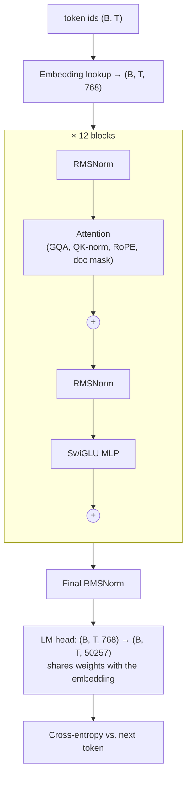

# Design: baseline model

Status: implemented (Phase 0) · Code: [`src/llmsys/model.py`](../../src/llmsys/model.py) ·
Tests: [`tests/test_model.py`](../../tests/test_model.py) · Last updated: 2026-10-10

## Summary

A **decoder-only transformer in the Llama style**, at GPT-2-small scale: 12 layers, width 768, 114.1M parameters.
It reads a sequence of token ids and, at every position, predicts the next token.

Beyond the classic Llama recipe (RoPE, RMSNorm, SwiGLU, no biases) it has the three features current open models
use: **grouped-query attention**, **QK-norm**, and **document masking** for packed training sequences. Each one
can be turned off with a config flag, so its cost can be measured on its own.

This is the **baseline**: it is written for clarity, not speed. Section [Deliberate inefficiencies](#deliberate-inefficiencies)
lists what is slow on purpose; those are the targets for later phases.

## The big picture

A language model is trained on one task: *given the tokens so far, give a probability for every possible next
token.* A token is a piece of a word (GPT-2's tokenizer has 50,257 of them). The model is a stack of identical
**blocks** between an input lookup and an output projection:



`B` = batch size (sequences per step), `T` = sequence length (tokens per sequence, up to 1024).

Two ideas make the stack work:

- **Residual stream.** Each block *adds* its output to its input (`x = x + attn(...)`, `x = x + mlp(...)`)
  instead of replacing it. The running vector `x` (768 numbers per token) is the "residual stream"; every block
  reads from it and writes a small update. This is what lets deep stacks train.
- **Pre-norm.** Each sub-layer normalizes its *input* (`attn(norm(x))`), not its output. The residual stream
  itself is never normalized until the very end. This keeps training stable without careful warm-up tricks.

Inside a block, **attention** is the only place where tokens exchange information (each token looks at earlier
tokens); the **MLP** processes each token on its own.

## Configuration

From `ModelConfig` (defaults):

| Field | Value | Meaning |
|---|---|---|
| `vocab_size` | 50,257 | GPT-2 tokenizer |
| `n_layers` | 12 | blocks |
| `d_model` | 768 | width of the residual stream |
| `n_heads` | 12 | query heads |
| `n_kv_heads` | 4 | key/value heads (GQA: 3 query heads share each) |
| `head_dim` | 64 | `d_model / n_heads` |
| `ffn_hidden` | 2048 | SwiGLU hidden width (8/3 × 768) |
| `max_seq_len` | 1024 | longest sequence; sizes the RoPE tables |
| `rope_theta` | 10,000 | RoPE base frequency |
| `norm_eps` | 1e-6 | RMSNorm epsilon |
| `qk_norm` | True | RMSNorm on queries and keys |
| `doc_masking` | True | block attention across documents |
| `eot_id` | 50256 | `<\|endoftext\|>`, marks the start of each document |
| `tie_embeddings` | True | LM head reuses the embedding matrix |
| `init_std` | 0.02 | weight init scale |

## Components

### Token embedding

A table of 50,257 rows × 768 columns. Token id `i` becomes row `i`. There is **no position embedding** added
here; position enters only inside attention, through RoPE.

### RMSNorm

Rescales each token's vector so its root-mean-square is 1, then multiplies by a learned per-channel weight
(initialized to 1):

```text
RMSNorm(x) = x / sqrt(mean(x²) + eps) * weight
```

It replaces GPT-2's LayerNorm, which also subtracts the mean and adds a bias. Dropping those is cheaper and
works as well in practice. Used by Llama, Qwen, Mistral, DeepSeek, and others.

### Attention

Attention lets each token gather information from earlier tokens. For every token it computes three vectors:

- a **query** ("what am I looking for?"),
- a **key** ("what do I contain?"),
- a **value** ("what do I pass on if selected?").

The score between token `i` and token `j` is `qᵢ · kⱼ / sqrt(head_dim)`. Scores are masked (see below),
turned into weights with softmax, and used to average the values. This happens in parallel in several
**heads**, each with its own 64-dim slice, so different heads can track different relationships. The heads'
outputs are concatenated and mixed by the output projection `o_proj`.

The steps, with shapes for one block (B = batch, T = tokens):

| Step | Code | Shape |
|---|---|---|
| Project | `q_proj`, `k_proj`, `v_proj` | q: (B, T, 12, 64); k, v: (B, T, 4, 64) |
| QK-norm | `q_norm`, `k_norm` | unchanged |
| Rotate by position | `apply_rope` | unchanged (after moving heads first: (B, heads, T, 64)) |
| Copy K/V heads for GQA | `repeat_interleave` | k, v: (B, 12, T, 64) |
| Scores | `q @ kᵀ / 8` | (B, 12, T, T) |
| Mask, softmax, mix values | `masked_fill`, `softmax`, `@ v` | (B, 12, T, 64) |
| Merge heads, project | `o_proj` | (B, T, 768) |

#### Grouped-query attention (GQA)

Standard multi-head attention gives every query head its own key and value head. GQA lets a **group of query
heads share one key/value head**: here 12 query heads and 4 K/V heads, so query heads 0–2 use K/V head 0,
heads 3–5 use K/V head 1, and so on (`h // 3`).

Why: during generation the model stores every past token's keys and values (the **KV cache**). With 4 K/V heads
instead of 12, the cache is **3× smaller**, which means longer contexts and bigger batches fit in memory, and
decoding (which is limited by memory bandwidth) gets faster. Quality loss is small. Used by Llama 2 70B and all
Llama 3 models, Qwen 2/3, Mistral, and Gemma 2/3.

`n_kv_heads = n_heads` gives standard multi-head attention; `n_kv_heads = 1` gives multi-query attention.

#### QK-norm

An RMSNorm applied to each query and key head (over its 64 dims) **before** RoPE. One weight vector of size 64
is shared by all query heads, another by all key heads.

Why: without it, the size of queries and keys can drift upward during training, scores become huge, the softmax
saturates into a near one-hot choice, and training can spike or diverge. Normalizing q and k bounds the scores.
Used by Qwen3 and OLMo 2.

We follow **Qwen3's placement** (per head, before RoPE). OLMo 2 normalizes the whole projection before splitting
into heads. We picked Qwen3's form because a small Qwen3 checkpoint is a candidate for our inference work.

#### RoPE (rotary position embedding)

Attention by itself has no idea of order. RoPE adds it by **rotating** each query and key by an angle that
grows with the token's position. The 64 dims are treated as 32 pairs; pair `i` rotates at its own speed
`θᵢ = 10000^(−2i/64)`, from fast (pair 0) to very slow (pair 31).

The key property: the dot product of a query rotated to position `m` and a key rotated to position `n` depends
only on **`m − n`**, the distance between them. So attention sees relative positions, not absolute ones.

A small worked example, one pair, angle per step `θ = 0.1` rad:

- `q = (1, 0)` at position 5 → rotated by 0.5 rad. `k = (1, 0)` at position 3 → rotated by 0.3 rad.
- Their dot product is `cos(0.5 − 0.3) = cos(0.2) ≈ 0.980`.
- Move both forward by 100 positions (105 and 103): `cos(10.5 − 10.3)` is still `cos(0.2)`.

**Layout:** we use the "rotate-half" layout (dim `i` pairs with dim `i + 32`), which is what Hugging Face
Llama and Qwen checkpoints expect. Meta's original Llama code pairs adjacent dims (0–1, 2–3, …) instead; the two
are equivalent up to a reordering of weights.

**θ = 10,000** is fine for 1024-token context. Long-context models raise it (Llama 3: 500,000; Qwen3:
1,000,000); we will revisit it for the long-context studies.

#### Masks: causal + document

The mask decides which scores are allowed (True) and which are set to −∞ before softmax (weight 0).

- **Causal:** token `i` may only look at tokens `j ≤ i`. Without this, the model could read the answer it is
  supposed to predict.
- **Document:** training packs several documents into each 1024-token sequence with no padding. Each document
  starts with `<|endoftext|>`, so a running count of those tokens gives every position a document number
  (`doc_ids_from_tokens`). Token `i` may only look at token `j` if both have the same document number.
  Without this, a recipe could "see" an unrelated news article that happened to land before it in the same
  sequence. Llama 3 trains this way.

Example, 8 tokens where `E` is `<|endoftext|>`:

```text
tokens   a  b  E  c  d  E  f  g
doc id   0  0  1  1  1  2  2  2
```

Token `d` (position 4) may attend to positions 2, 3, 4 only. Token `f` may attend to positions 5 and 6 only.
The first piece (`a b`) is the tail of a document cut off by the previous sequence; it gets its own doc id 0.

**Positions are not reset per document.** Because RoPE only sees relative distance, and cross-document scores
are masked anyway, a document gets the same attention whether it starts at position 0 or 500.
`test_doc_masking_isolates_documents` checks exactly this: a document packed after another gives the same
logits as when it is run alone.

The token just before `E` is trained to predict `E`: the model learns where documents end. `E` itself sees only
itself and is trained to predict the new document's first token, like a "beginning of text" marker.

### SwiGLU MLP

Per token: `down( silu(gate(x)) ⊙ up(x) )`, with `gate` and `up` 768 → 2048 and `down` 2048 → 768.

`silu(z) = z · sigmoid(z)` is a smooth activation; `⊙` is elementwise multiply. The `gate` branch decides, per
hidden unit, how much of the `up` branch passes through. This gated form beats the plain GPT-2 MLP
(`down(gelu(up(x)))`) at the same compute. Because it has three matrices instead of two, the hidden width is
cut from 4 × 768 to 8/3 × 768 = 2048 to keep parameters and FLOPs the same. Used by Llama, Qwen, Mistral,
DeepSeek, and others.

### LM head and loss

The final RMSNorm, then a 768 → 50,257 projection gives one score (**logit**) per vocabulary entry. Softmax
turns logits into probabilities. The loss is **cross-entropy**: the negative log of the probability given to
the true next token, averaged over all positions.

**Tied embeddings:** the LM head reuses the embedding matrix. Untied, the vocabulary would cost 2 × 38.6M
parameters, a third of the whole model. Small models tie for this reason: GPT-2, Llama 3.2 1B/3B, small Qwen3
models, Gemma. Larger models (Llama 3 8B+) untie, since the vocabulary is then a small share of parameters.

## Parameter count

| Part | Formula | Parameters |
|---|---|---|
| Embedding (= LM head, tied) | 50,257 × 768 | 38,597,376 |
| Attention, per layer | 768×768 (q) + 2 × 768×256 (k, v) + 768×768 (o) | 1,572,864 |
| SwiGLU, per layer | 3 × 768 × 2048 | 4,718,592 |
| Norms, per layer | 2 × 768 + 2 × 64 | 1,664 |
| × 12 layers | | 75,517,440 |
| Final norm | 768 | 768 |
| **Total** | | **114,115,584** |

The plan calls this "the 124M model" after GPT-2 small. We are 10M smaller because GQA shrinks the K/V
projections (−9.4M) and RoPE needs no learned position table (GPT-2 small has a 0.8M one). Comparisons with
GPT-2-small-sized references (such as modded-nanogpt) are therefore approximate; say so in write-ups.

## Initialization

- All weight matrices (including the embedding): normal, std 0.02 (GPT-2's scheme).
- `o_proj` and `down_proj`, the two layers that write into the residual stream: std `0.02 / sqrt(2 × 12)`.
  Each layer adds two updates to the stream; without this scaling, the stream's size would grow with depth.
- All norm weights: 1.

Measured at init (2026-10-10, CPU, seed 0, random tokens and targets, B=2, T=256):

| | Loss | Notes |
|---|---|---|
| Uniform guess, ln(50257) | 10.83 | reference |
| Tied (default) | 10.95 | healthy start |
| Tied, target = input token | 9.22 | each token's own logit starts slightly ahead, because the LM head reuses its embedding row |
| Untied | 10.98 | |

The self-token head start is a side effect of tying. It is small at full size because the 24 residual updates
mostly bury the embedding signal; in the tiny test model it is much larger, which is why the init-loss test
uses random targets.

## Deliberate inefficiencies

The baseline favours readability. Each item below is a later optimization target, to be justified by a profile
before it is changed.

| Inefficiency | Cost | Planned fix |
|---|---|---|
| fp32 everywhere | 2× memory traffic of bf16; no tensor cores without TF32 | Phase 2: TF32, bf16 autocast |
| Full (B, 12, T, T) score matrix in memory | memory and traffic grow with T²; causal/doc-masked blocks still computed | Phase 2–3: SDPA, FlexAttention block masks, FlashAttention varlen, custom kernel |
| Mask materialized per batch as (B, 1, T, T) booleans | extra memory; likely knocks SDPA off its fast path | Phase 2: FlexAttention block mask / varlen |
| K/V copied 3× for GQA (`repeat_interleave`) | extra memory and traffic | Phase 2: native GQA in SDPA |
| Separate Q, K, V matmuls; norm and RoPE as separate ops | 3 small matmuls + many elementwise passes over memory | Phase 3: fused QKV → QK-norm → RoPE kernel |
| Unfused RMSNorm, SwiGLU elementwise ops | each op reads and writes the full tensor | Phase 3: Triton kernels / torch.compile |
| Full (B, T, 50257) fp32 logits for the loss | ~206 MB per 1024-token sequence (T·V·4 bytes), plus the same again for its gradient | Phase 3–4: fused linear + cross-entropy, chunked loss |
| Vocab 50,257 not a multiple of 64/128 | awkward matmul tile shapes | Phase 3: pad vocab to 50,304 and measure |

## How correctness is checked

[`tests/test_model.py`](../../tests/test_model.py), run in CI on CPU:

| Test | What it proves |
|---|---|
| `test_param_count_default_config` | full config has exactly the parameters in the table above |
| `test_tied_embeddings` | LM head and embedding are the same tensor |
| `test_initial_loss_near_uniform` | init is sane: loss ≈ ln(vocab) |
| `test_causal` | changing future tokens never changes earlier outputs |
| `test_doc_masking_isolates_documents` | packed documents can't see each other, and no position reset is needed |
| `test_naive_attention_matches_sdpa` | our attention equals PyTorch's reference implementation with the same mask |
| `test_gqa_equals_mha_with_copied_kv_heads` | GQA's head grouping is right (query head `h` ↔ K/V head `h // 3`) |
| `test_qk_norm_flag` | the flag adds exactly the expected parameters |
| `test_overfits_single_batch` | gradients flow everywhere and the model can learn |
| `test_mps_matches_cpu` | same outputs on Apple MPS (skipped in CI) |

Every later optimization must keep these passing **and** reproduce the baseline loss curve.

## Considered and rejected

| Choice | Why not |
|---|---|
| Learned absolute position embeddings (GPT-2) | modern models use RoPE; RoPE generalizes by relative distance and needs no parameters |
| LayerNorm, biases | no benefit at this scale; RMSNorm and no biases are the modern default |
| Dropout | not used in modern pretraining (data is seen roughly once, so overfitting is not the issue) |
| Untied embeddings | +38.6M params (+34%) at this size for little gain |
| Resetting RoPE positions per document | unnecessary with RoPE + doc masking (see above) |
| Interleaved RoPE layout (Meta original) | rotate-half matches the Hugging Face checkpoints we will load |
| Attention logit soft-capping (Gemma 2) | dropped by later models; breaks standard attention kernels |
| Larger vocab (e.g. 128K) | the embedding alone would be ~98M params at d=768 and dominate the model |

## Open questions

- Target sequence length for throughput runs: 1024 (GPT-2 / early modded-nanogpt) or longer. Decide after the
  baseline profile.
- Whether to keep θ = 10,000 for the long-context studies or raise it (and how that interacts with
  extending context of an already-trained model).
